# ConduitOT

**Design, document and share operational technology (OT) network architectures in the browser.**

ConduitOT is a visual editor for industrial network architectures. You place controllers, field devices, servers and network gear on the levels of the Purdue reference model, then group them into IEC 62443 security zones. You draw the network links and industrial protocol flows between them and write the firewall rules that govern them. The result is one validated JSON file that you can save, version, compare, share as a link and export as diagrams, spreadsheets or a written architecture record.

Everything runs in your browser. There is no server, no account, no tracking, and the app makes no network requests after it has loaded.

**Live app:** [conduitot.vijaykumarkk.in](https://conduitot.vijaykumarkk.in/)

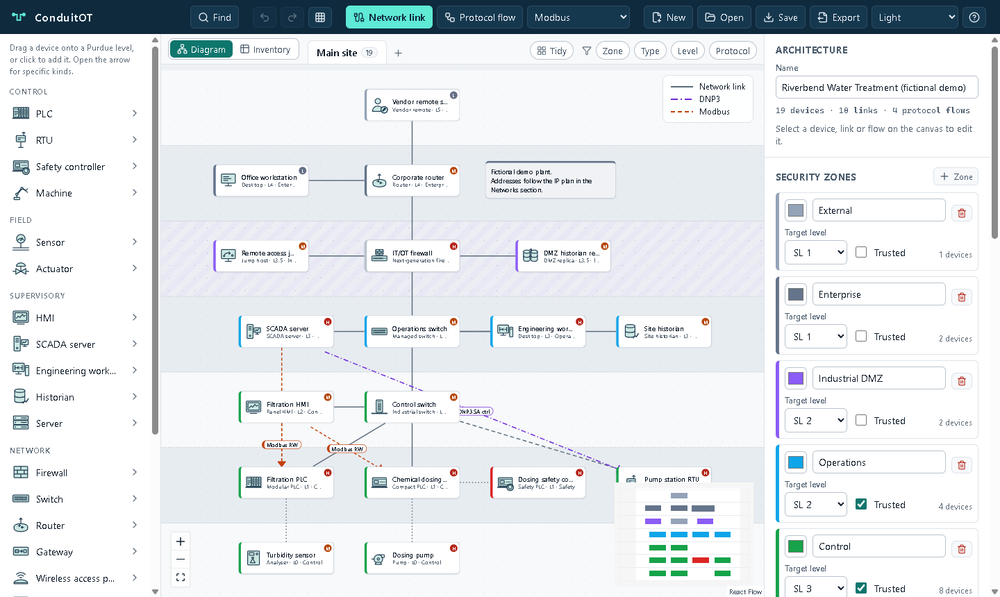

---

## Contents

1. [Why ConduitOT exists](#1-why-conduitot-exists)
2. [Core ideas in five minutes](#2-core-ideas-in-five-minutes)
3. [A tour of the screen](#3-a-tour-of-the-screen)
4. [Feature guide](#4-feature-guide)
5. [Typical workflows](#5-typical-workflows)
6. [How the app is built](#6-how-the-app-is-built)
7. [Source code map](#7-source-code-map)
8. [Data model and file format](#8-data-model-and-file-format)
9. [How an edit flows through the app](#9-how-an-edit-flows-through-the-app)
10. [Drawing the canvas](#10-drawing-the-canvas)
11. [Opening files: migration and validation](#11-opening-files-migration-and-validation)
12. [Autosave and restore](#12-autosave-and-restore)
13. [Revisions and the change diff](#13-revisions-and-the-change-diff)
14. [IP and VLAN planning](#14-ip-and-vlan-planning)
15. [Share links](#15-share-links)
16. [CSV import and export](#16-csv-import-and-export)
17. [Tidy layout](#17-tidy-layout)
18. [Catalogs: devices, protocols, templates](#18-catalogs-devices-protocols-templates)
19. [Themes and accessibility](#19-themes-and-accessibility)
20. [Privacy and security](#20-privacy-and-security)
21. [Technology choices](#21-technology-choices)
22. [Development guide](#22-development-guide)
23. [Testing](#23-testing)
24. [Project history](#24-project-history)
25. [Known limitations](#25-known-limitations)
26. [Keyboard shortcuts](#26-keyboard-shortcuts)
27. [Licence](#27-licence)

---

## 1. Why ConduitOT exists

Industrial plants, utilities, pipelines and buildings run on control systems: PLCs, RTUs, HMIs, SCADA servers, historians, safety controllers. The networks that connect them are often described in general-purpose drawing files and separate spreadsheets. Over time those drift apart:

- the diagram shows a device that the asset list does not;
- nobody can say which zones talk to each other, or over which protocol;
- firewall rules live in yet another document;
- a change made last month is not visible anywhere.

ConduitOT keeps **one structured model** of the architecture and generates every view from it, so the diagram, the inventory, the IP plan and the written record always agree.

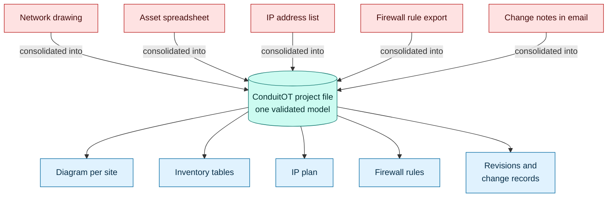

### Design goals

| Goal | How it shows up |
|------|-----------------|
| **Speak the domain's language** | Purdue levels, IEC 62443 zones and conduits, real industrial protocols and their settings, device kinds that engineers recognise |
| **One source of truth** | Every view (diagram, tables, exports, IP plan, change list) is computed from the same project model |
| **Private by default** | Designs contain IP addresses and firewall rules, so nothing leaves the browser; share links keep the design out of server requests |
| **Plain, durable files** | A readable JSON file with a documented schema, automatic upgrades from older versions, and strict validation on open |
| **Usable by everyone** | Full keyboard operation, screen-reader labels, light, dark and high-contrast themes |
| **Safe to experiment** | Undo and redo, autosave, named revisions, and confirmation before anything destructive |

### What it is not

ConduitOT is a design and documentation tool. It does not connect to, scan or configure real devices, and it does not score or audit security. It records what you design.

---

## 2. Core ideas in five minutes

### 2.1 The Purdue reference model

The canvas of each site is divided into horizontal **lanes**, one per Purdue level. A device's level follows the lane it is placed in: drag it into another lane and its level changes with it.

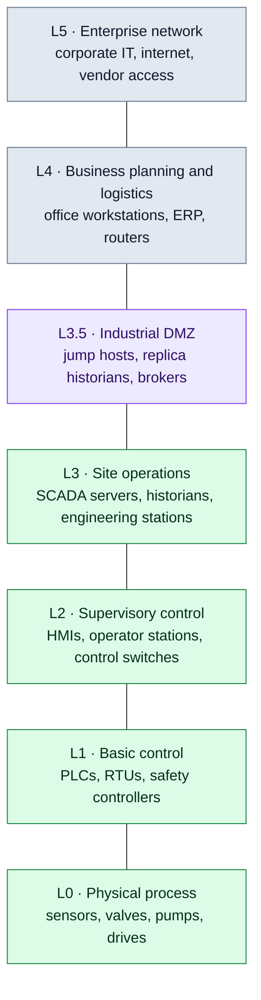

### 2.2 Zones and conduits (IEC 62443)

A **zone** is a group of devices with shared security requirements. It has a colour, a *trusted* flag and a target security level (SL 1 to 4). A **conduit** is any pair of zones joined directly by a network link or protocol flow. Conduits are never typed in by hand: ConduitOT derives them from the connections you draw.

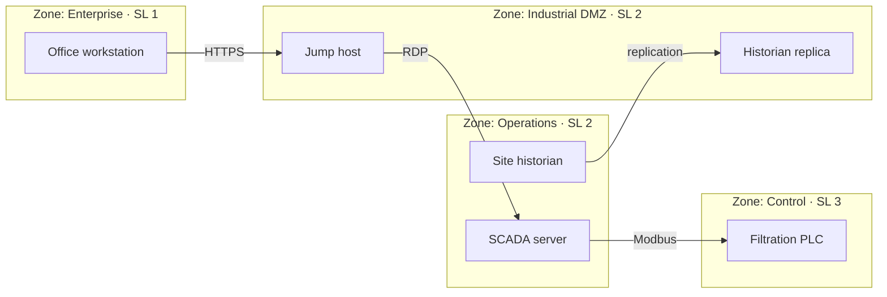

From that drawing the app lists three conduits: Enterprise ↔ DMZ, DMZ ↔ Operations and Operations ↔ Control.

### 2.3 The building blocks of a design

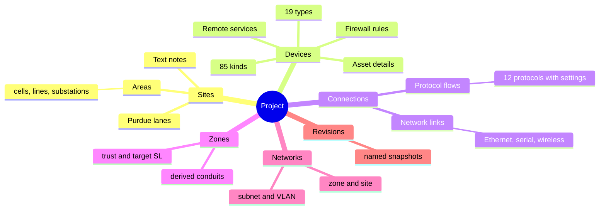

---

## 3. A tour of the screen

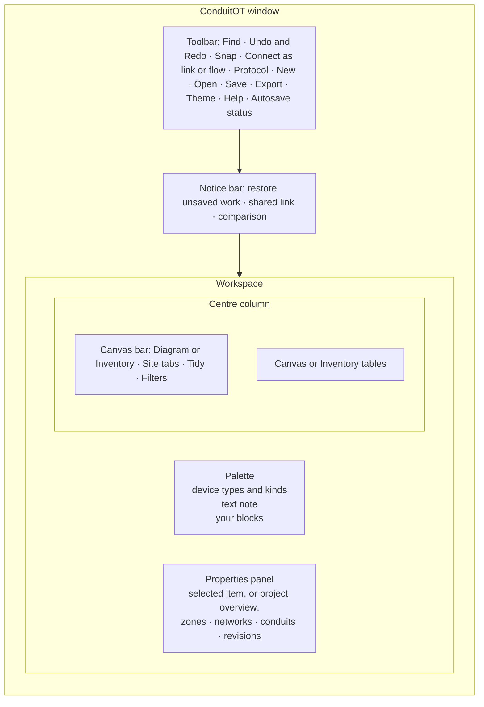

| Area | What it is for |
|------|----------------|
| **Toolbar** | File commands, undo and redo, how new connections are drawn, export and share, theme, help |
| **Palette** (left) | Drag a device type or a specific kind onto a lane, or click to add it. Also holds the text note tool and your saved blocks |
| **Canvas** (centre) | The diagram for the open site: lanes, areas, devices, links, flows, notes and stubs for devices on other sites |
| **Inventory** (centre, second view) | Sortable, editable tables of devices, flows, firewall rules and the IP plan |
| **Properties panel** (right) | Edits whatever is selected. With nothing selected it shows the project: zones, networks, conduits and revisions |

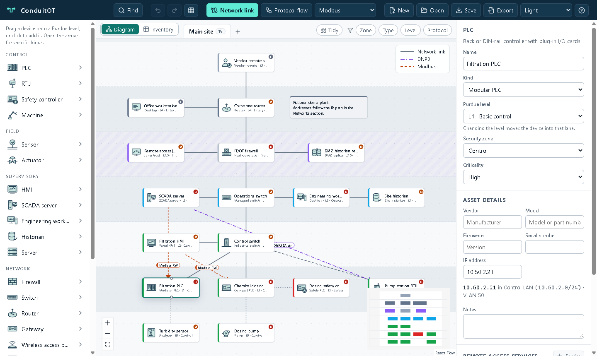

---

## 4. Feature guide

### 4.1 Modelling

- **Devices:** 19 types and 85 kinds, for example a compact, modular or micro PLC, a PAC, a protection relay, a merging unit, a data diode or a cellular router. Each kind has its own original two-tone icon.
- **Asset details:** vendor, model, firmware, serial number, one or more IP addresses, and notes.
- **Criticality:** low, medium or high, shown as a lettered badge on the device.
- **Remote-access services:** RDP, SSH, VNC or HTTPS listeners with their ports.
- **Network links:** undirected Ethernet, serial or wireless connections. Each records the port or interface at both ends (shown on the canvas), its VLANs (one for an access port, several for a trunk) and the planned network it carries. A warning appears when an end device has no address in that network, or when the link does not carry the network's VLAN.
- **Protocol flows:** directed sessions with protocol-specific roles (client → server, master → outstation, publisher → subscriber) and settings such as TLS, access mode or security mode. Each protocol has its own colour *and* dash pattern.
- **Firewall rules:** an ordered, first-match list of allow and deny rules per firewall, with a default action. Sources and destinations can be *any*, a zone or a device.
- **Zones and conduits:** see [section 2.2](#22-zones-and-conduits-iec-62443).
- **Text notes:** free text on the canvas for legends, remarks and open questions.

### 4.2 Large estates

- **Sites:** each site has its own tab and its own lanes. A connection to a device on another site is drawn to a small *stub* in a column on the right, and clicking the stub opens that site.
- **Areas:** dashed frames for cells, production lines or substations. Devices inside an area move with it, and an area can **collapse** into a single node whose connections are merged.
- **Search** (Ctrl + K or /): finds devices on every site by name, kind, IP address, vendor, model or notes.
- **Filters:** by zone, device type, level or protocol. Items that do not match are dimmed, not hidden, so the layout stays readable.

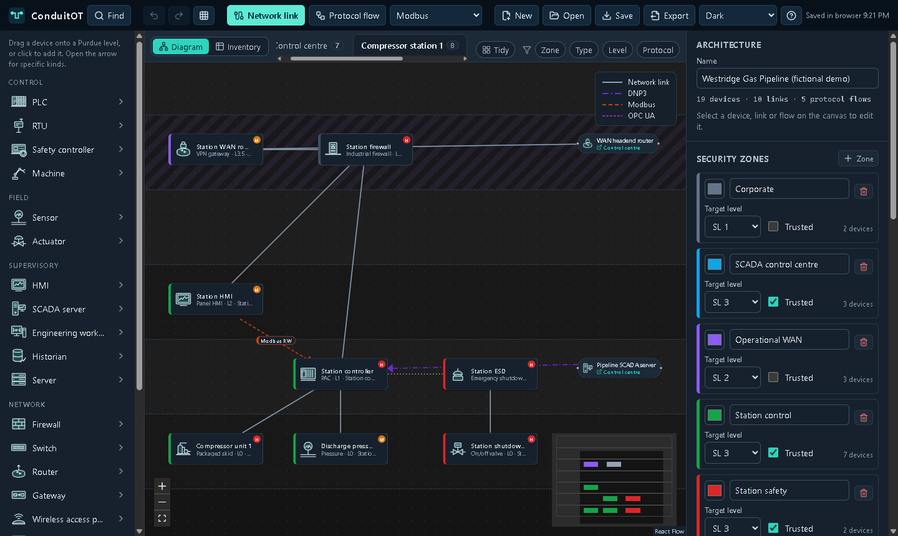

### 4.3 Editing

- Undo and redo (100 steps; rapid edits to the same field merge into one step).
- Copy, paste, duplicate, select all, and box selection with Shift + drag.
- Bulk editing of zone, criticality and site, plus align and distribute.
- Snap to grid, a right-click menu on devices, and **Tidy layout** for a whole site.
- **Bend points:** double-click a link or flow to bend it, drag the handle to move it, and double-click the handle to remove it; **Straighten** in the properties panel removes them all.
- **Lock** devices, notes and areas so they cannot be dragged; Tidy, align and distribute leave them in place.
- **View menu:** show or hide network links, protocol flows, flow labels, port names, notes and area frames. The choice is remembered in the browser.
- **Reusable blocks:** save a group of devices with their links and flows, then insert copies from the palette.
- **Autosave** to the browser one second after each change, with an offer to restore it next time.

### 4.4 Templates

Five fictional reference architectures, chosen from **New**:

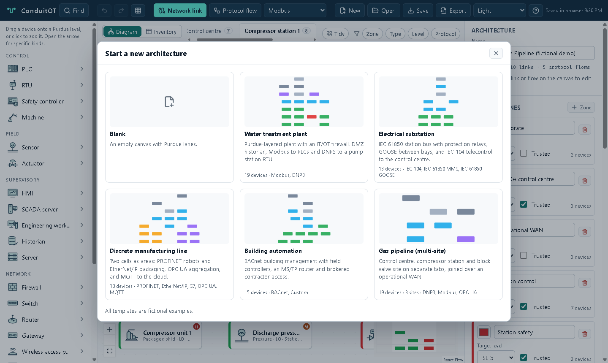

### 4.5 Inventory

A table view of the same model, with tabs for devices, links (ports, VLANs, networks), protocol flows, firewall rules and the IP plan. Edits made here go through the same undoable operations as the diagram.

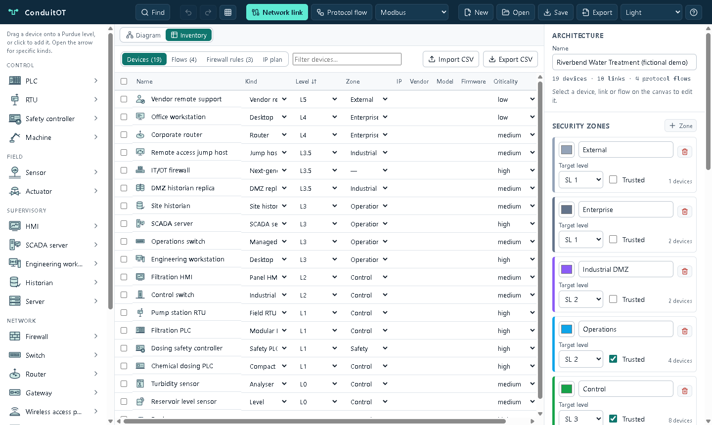

### 4.6 IP and VLAN planning

Define the IPv4 networks in use, with subnet, VLAN, zone and site. Every device address is matched to its network. The app warns about:

- duplicate addresses;
- malformed addresses;
- network or broadcast addresses;
- addresses outside every planned network;
- addresses whose network belongs to another zone.

The **IP plan** tab lists every address in numeric order. See [section 14](#14-ip-and-vlan-planning) for the rules.

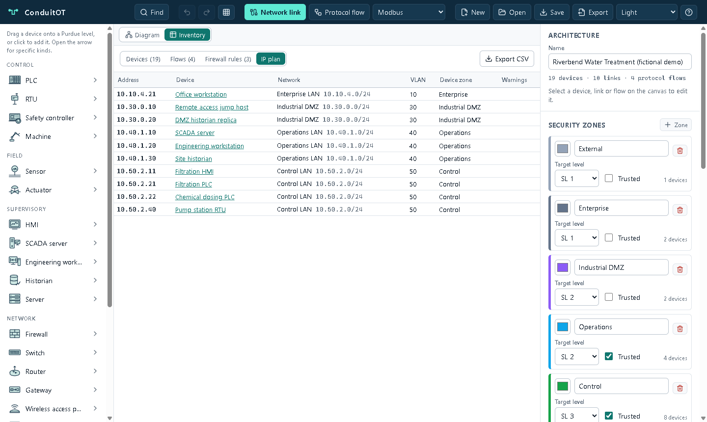

### 4.7 Revisions and change records

Save the design under a name such as "Baseline" and compare later work against it:

- added items get a solid green outline and a "New" tag;
- changed items get a dashed amber outline and a "Changed" tag;
- removed items are listed in the Changes panel.

The change list can be downloaded as a Markdown change record. See [section 13](#13-revisions-and-the-change-diff).

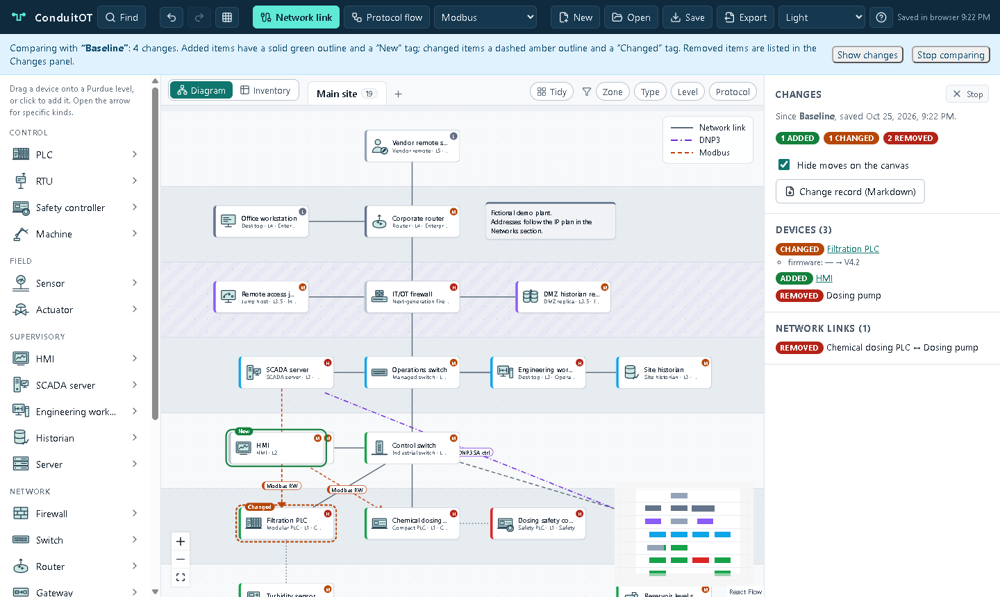

### 4.8 Import, export and sharing

| Output | Format | Notes |
|--------|--------|-------|
| Project file | `.conduitot.json` | The complete design, including revisions |
| Diagram | SVG, PNG | The open site, as drawn |
| Printable diagram | PDF via the browser's print dialog | Uses a print stylesheet |
| Architecture record | Markdown | Zones, networks, conduits, and per site: devices, flows, firewall rules and notes |
| Change record | Markdown | Changes since a chosen revision |
| Tables | CSV | Devices, links, flows, firewall rules, IP plan |
| Share link | URL | The whole design inside the link; see [section 15](#15-share-links) |

| Input | Format |
|-------|--------|
| Project file | `.json` from any ConduitOT version |
| Devices, links, flows, firewall rules | CSV in the same columns as the exports |
| Shared design | A share link opened in the browser |

---

## 5. Typical workflows

### 5.1 Documenting an existing site

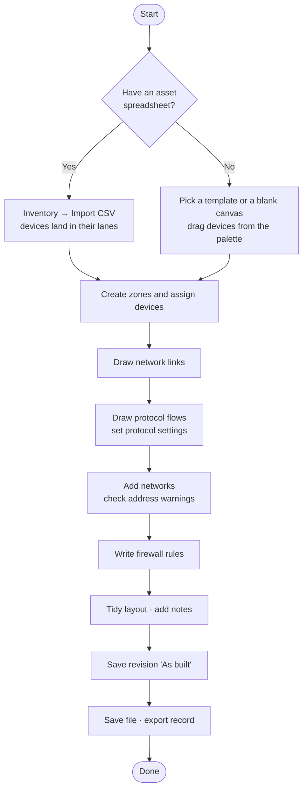

### 5.2 Planning and recording a change

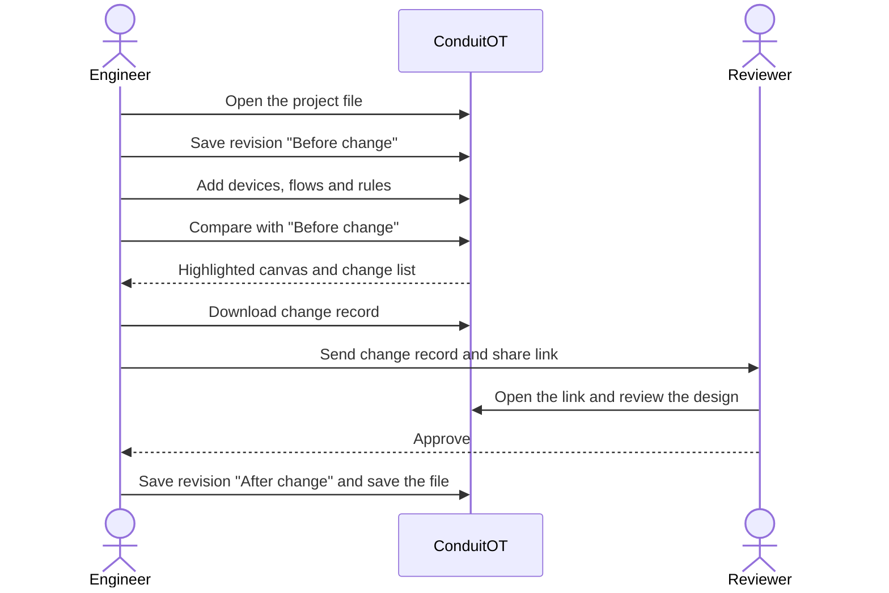

---

## 6. How the app is built

ConduitOT is a single-page application. Its static files can be served from any web host; the live app is served by Vercel. Once the page has loaded, all work happens in the browser.

### 6.1 Runtime picture

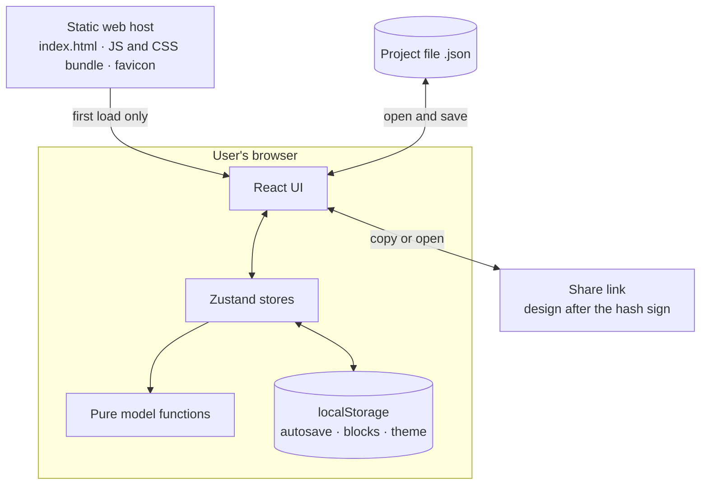

### 6.2 Layers

The code is split into three layers with one-way dependencies. The model layer knows nothing about React, so every rule in it is unit-tested directly.

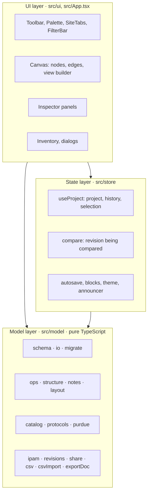

### 6.3 Principles that shape the code

| Principle | Consequence |
|-----------|-------------|
| **The schema is the source of truth** | `src/model/schema.ts` defines the file format with zod; TypeScript types are inferred from it, so types and validation cannot drift apart |
| **Edits are pure functions** | Every change is `(project) => project` in the model layer. The store applies it, records undo history and notifies the UI |
| **Views are derived, never stored** | Conduits, the canvas nodes, the IP report and the change list are all computed from the project on demand |
| **Warnings are not errors** | Half-typed IP addresses or subnets never block saving; they show as warnings. Only structural problems stop a file from opening |
| **Storage is optional** | Every `localStorage` access is wrapped so the editor still works in private windows or with site data blocked |

---

## 7. Source code map

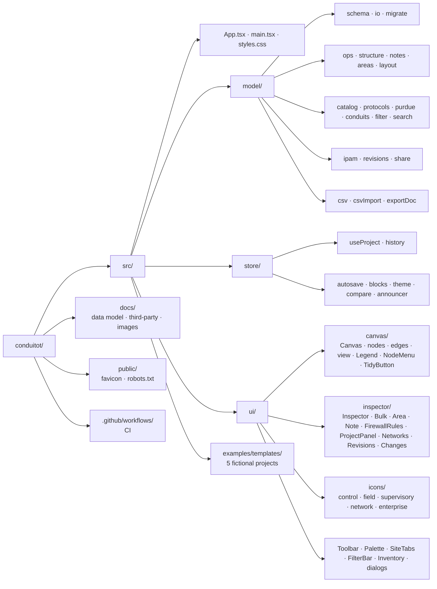

| Path | Responsibility |
|------|----------------|
| `src/model/schema.ts` | zod schema for the whole project file; exported TypeScript types |
| `src/model/migrate.ts` | Upgrades older files step by step (v1 → v2 → v3 → v4) |
| `src/model/io.ts` | Parse, migrate, validate and cross-check a file; serialise a project |
| `src/model/ops.ts` | Device, link, flow, zone and rule operations; copy and paste; align and distribute |
| `src/model/structure.ts` | Sites and areas |
| `src/model/notes.ts` | Canvas notes |
| `src/model/layout.ts` | Tidy layout |
| `src/model/catalog.ts` | Device types, kinds, default levels and palette groups |
| `src/model/protocols.ts` | Protocol registry: roles, ports, settings, colours, labels |
| `src/model/ipam.ts` | IPv4 parsing, subnet matching and address warnings |
| `src/model/revisions.ts` | Saving and restoring revisions; the change diff; Markdown change records |
| `src/model/share.ts` | Encoding and decoding share links |
| `src/model/csv.ts`, `csvImport.ts` | CSV export of every table; CSV import of devices, flows and rules |
| `src/model/exportDoc.ts` | The Markdown architecture record |
| `src/store/useProject.ts` | The main store: project, undo history, selection, active site, filter, clipboard |
| `src/store/history.ts` | Pure undo and redo with edit coalescing |
| `src/ui/canvas/view.ts` | Pure function that turns the project into React Flow nodes and edges for one site |

---

## 8. Data model and file format

A project is one JSON document, currently `schemaVersion: 4`. The full field reference is in [docs/data-model.md](docs/data-model.md).

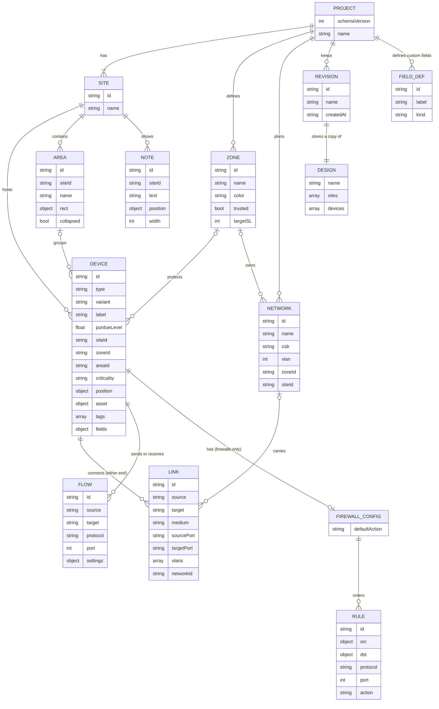

A shortened example:

```jsonc
{
  "schemaVersion": 4,
  "name": "Riverbend Water Treatment (fictional demo)",
  "sites":   [{ "id": "site-main", "name": "Main site" }],
  "devices": [{ "id": "plc-filter", "type": "plc", "variant": "modular", "label": "Filtration PLC",
                "purdueLevel": 1, "siteId": "site-main", "zoneId": "zone-control", "areaId": null,
                "criticality": "high", "position": { "x": 350, "y": 787 }, "services": [],
                "asset": { "vendor": "", "model": "", "firmware": "", "serial": "", "ip": "10.50.2.21", "notes": "" } }],
  "links":   [/* … */],
  "flows":   [{ "id": "flow-hmi-filter", "source": "hmi", "target": "plc-filter", "protocol": "modbus", "port": 502,
                "settings": { "variant": "tcp", "access": "read-write", "authentication": false } }],
  "zones":   [/* … */],
  "areas":   [],
  "notes":   [/* … */],
  "networks": [{ "id": "net-ctl", "name": "Control LAN", "cidr": "10.50.2.0/24", "vlan": 50,
                 "zoneId": "zone-control", "siteId": "site-main" }],
  "revisions": []
}
```

---

## 9. How an edit flows through the app

Every change, whether from the canvas, the properties panel, the inventory or the keyboard, follows the same path.

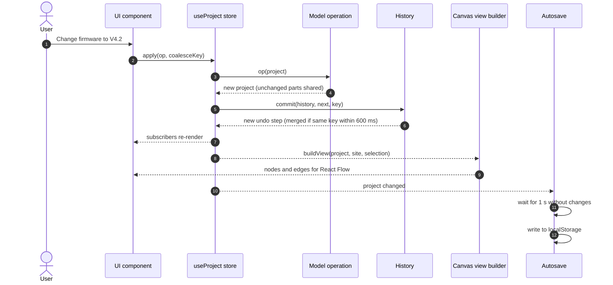

Undo and redo are pure functions over immutable snapshots:

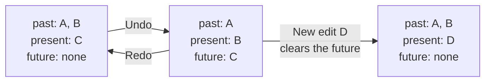

Up to 100 past snapshots are kept. Unchanged parts of the project are shared between snapshots, so history stays small.

---

## 10. Drawing the canvas

The canvas uses React Flow. What it shows for a site is computed by one pure, tested function, `buildView` in `src/ui/canvas/view.ts`.

**Nodes:**

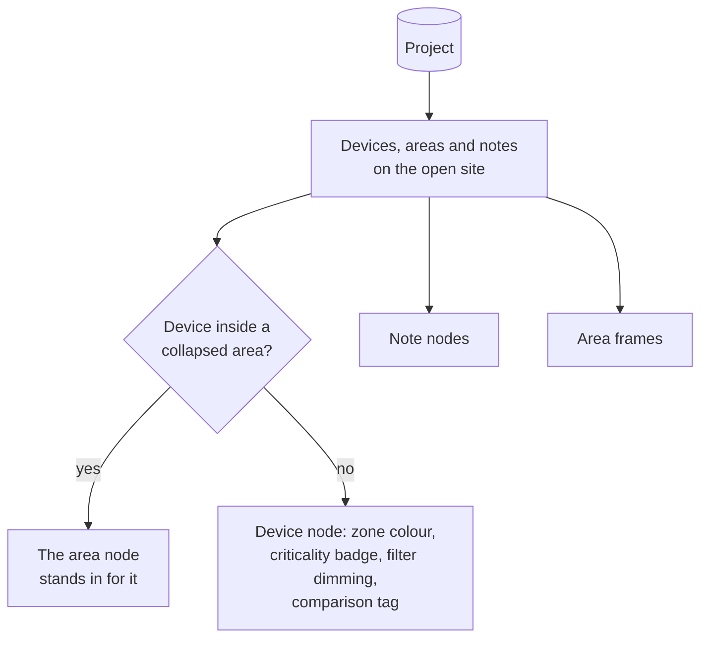

**Edges:**

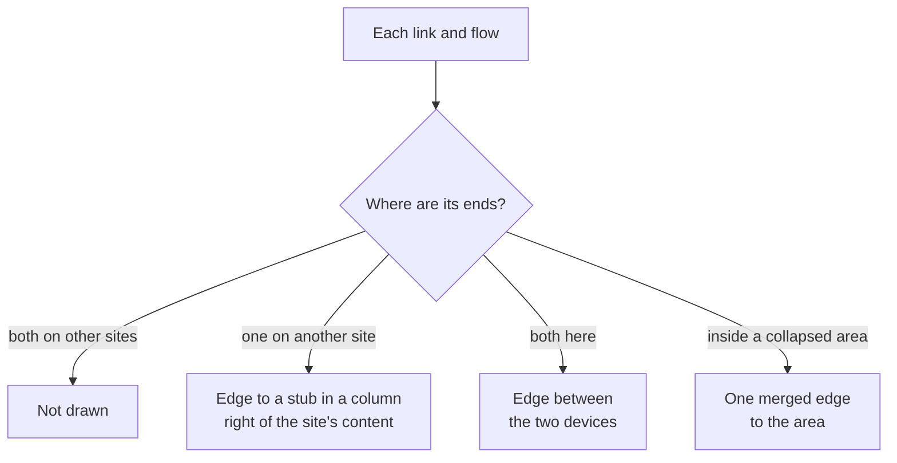

React Flow then draws these nodes and edges above the Purdue lanes, which are locked background nodes.

Some details worth knowing:

- **Lanes** are 150 px tall and drawn as locked background nodes. A device's level comes from where its centre is, so `NODE_HEIGHT` in `src/model/purdue.ts` must match the node height in `styles.css`.
- **Edges** are straight lines from border to border. Flows run slightly offset from links so both stay visible, and each flow's label shows its protocol and key settings, for example `Modbus RW`.
- **Moves** are committed when a drag ends, or immediately for arrow-key nudges, so a drag is one undo step.
- **Areas** carry their member devices while being dragged.

---

## 11. Opening files: migration and validation

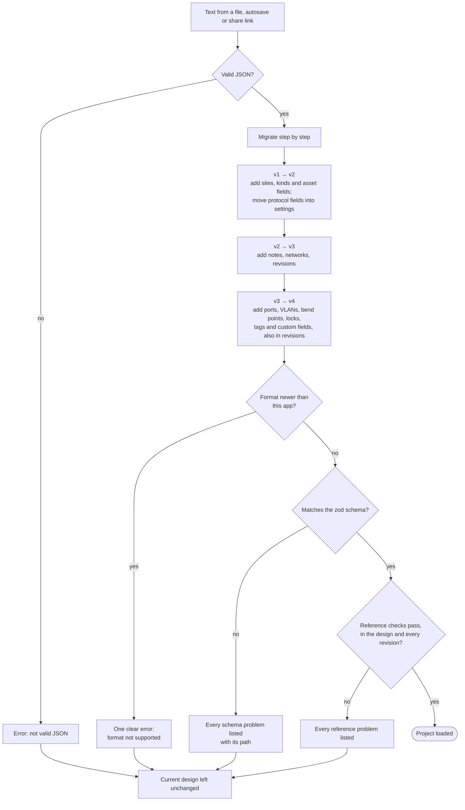

Reference checks cover what a schema alone cannot:

- every id is unique;
- links, flows, sites, zones, areas, notes, networks and rule endpoints point at things that exist;
- every device kind is in the catalog, and every flow's settings match its protocol;
- nothing connects a device to itself, and only firewalls carry rules.

---

## 12. Autosave and restore

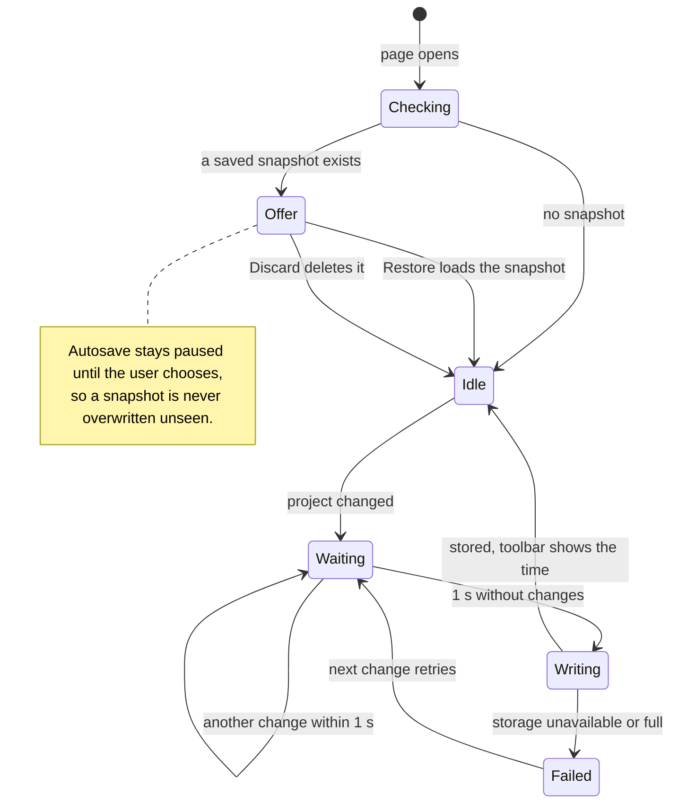

Autosave is per browser and per device. Saving the project file remains the way to keep and share work.

---

## 13. Revisions and the change diff

A revision is a deep copy of the design, stored inside the project file, so it travels with the file. Items keep their ids when copied, which makes the diff exact.

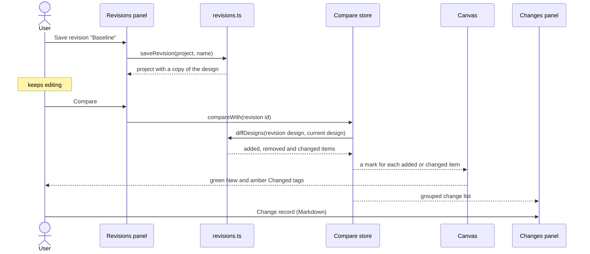

How the diff decides what changed:

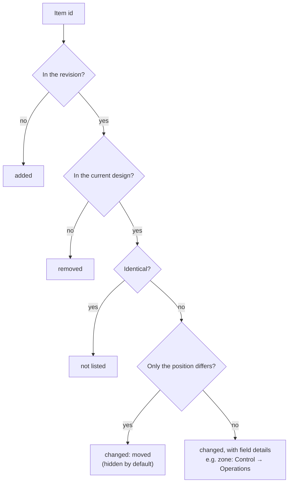

- Zone, site and area names are resolved inside each design, so renaming a zone is one change, not one per device.
- Firewall rule edits are listed as rule changes, with their position in the rule list.
- Restoring a revision replaces the design but keeps the revision list, and can be undone.

---

## 14. IP and VLAN planning

Networks are IPv4 subnets in CIDR form, each optionally tied to a VLAN, a zone and a site. A network with no site applies to every site, which suits a WAN. A device may list several addresses, one per interface, separated by commas, semicolons or spaces.

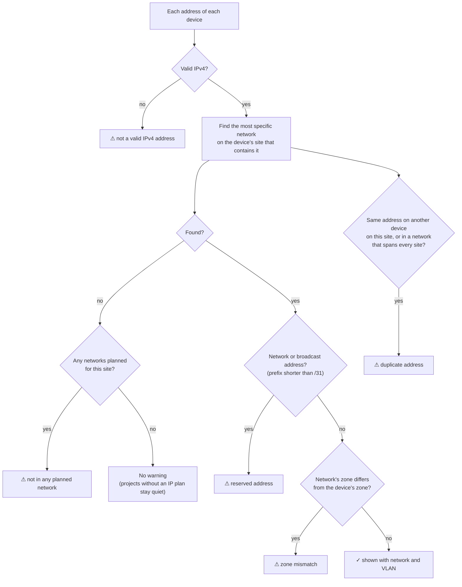

Each network also shows how many devices use it and how many host addresses it has. It warns about:

- malformed CIDRs, or CIDRs with host bits set (for example `10.0.1.5/24`, with a suggested fix);
- subnets that overlap another network on the same site;
- a VLAN id used by two different subnets on the same site.

None of these warnings stop a file from saving or opening.

---

## 15. Share links

A share link carries the whole design. Nothing is uploaded anywhere.

```mermaid
sequenceDiagram
    actor A as Sender
    participant SA as Sender's browser
    participant H as Web host
    participant SB as Receiver's browser
    actor B as Receiver
    A->>SA: Export, then Share as a link
    SA->>SA: Compress and encode the JSON
    SA-->>A: link with the design after the hash sign
    A->>B: Sends the link
    B->>SB: Opens the link
    SB->>H: GET / (fragment not sent)
    H-->>SB: The app
    SB->>SB: Decode (capped at 8 MB) and validate like a file
    SB-->>B: Banner offers Open it or Ignore
    B->>SB: Open it
    SB->>SB: Load design, clean the address bar
```

| Property | Value |
|----------|-------|
| Link format | `https://conduitot.vijaykumarkk.in/#share=v1.<compressed design>` |
| Typical length | 2,500 to 3,000 characters for a template |
| Revisions | Left out unless the sender includes them |
| Long links | Links over 8,000 characters get a warning, because some chat and mail tools shorten them |
| Safety | The design is validated exactly like an opened file, and replaces nothing until the receiver chooses **Open it** |

Anyone who has a link can read the full design, including addresses and firewall rules. Share links through the same channels you would use for the project file.

---

## 16. CSV import and export

Every table exports to CSV, and devices, links, flows and firewall rules import from the same columns. An exported table can therefore be edited in a spreadsheet and read back.

```mermaid
flowchart TD
    X["CSV file"] --> P["Parse with header row<br/>(papaparse)"]
    P --> R["Check each row on its own:<br/>types, kinds, names, protocols, ports, settings"]
    R --> OK["Valid rows"]
    R --> BAD["Rejected rows<br/>with line number and reason"]
    OK --> PV["Preview: N ready, M skipped"]
    BAD --> PV
    PV -- "Import" --> AP["Applied as one undoable step"]
```

| Table | Columns |
|-------|---------|
| Devices | `name, type, variant, level, zone, site, area, criticality, vendor, model, firmware, serial, ip, notes` |
| Links | `source, source port, target, target port, medium, vlans, network` (VLANs as `10 20` or `30-32`) |
| Flows | `source, target, protocol, port, summary, settings` (`settings` written as `name=value; name=value`) |
| Firewall rules | `firewall, order, action, source, destination, protocol, port, note` (endpoints as `any`, `zone: Name` or a device name) |
| IP plan (export only) | `address, device, site, network, subnet, vlan, zone, warnings` |

Import rules worth knowing:

- Device names must be unique for flows and rules to refer to them; an ambiguous name is rejected rather than guessed.
- Flow settings start from the protocol's defaults, and an empty port takes the protocol's default port.
- Rule import replaces the named firewalls' existing rules by default, so re-importing an edited export does not duplicate them. An option appends instead.
- Cells that a spreadsheet would run as a formula (starting with `=`, `+`, `-`, `@`, tab or carriage return) are escaped on export and restored on import.

---

## 17. Tidy layout

**Tidy** (in the canvas bar) arranges the open site in one undoable step. Devices keep their Purdue level, site and area; only their order and spacing within each lane change. Locked devices and areas stay put and the rest are placed around them, and bend points on the site are cleared.

```mermaid
flowchart TD
    S(["Tidy"]) --> A["Widen each area to fit its longest row"]
    A --> B["Push overlapping areas apart, left to right"]
    B --> C["Barycentre sweeps: L5 → L0, then L0 → L5, twice"]
    C --> D["In each lane, order devices by the average<br/>position of the devices they connect to"]
    D --> E["Place area members in rows centred in their area"]
    E --> F["Place other devices left to right,<br/>skipping the space taken by areas"]
    F --> G["Re-check area membership"]
    G --> H(["One undo step"])
```

Connected devices end up above and below each other, so most links run straight down the diagram.

---

## 18. Catalogs: devices, protocols, templates

### 18.1 Devices

There are 19 device types. Each has a generic kind plus specific kinds, 85 kinds in all, and each kind has its own icon. Open the app with `?gallery` to see them all.

```mermaid
pie showData
    title Device kinds by palette group (85)
    "Control" : 20
    "Field" : 15
    "Supervisory" : 21
    "Network" : 22
    "Enterprise and external" : 7
```

| Group | Types and number of kinds |
|-------|---------------------------|
| Control | PLC 7 · RTU 5 · Safety controller 4 · Machine 4 |
| Field | Sensor 8 · Actuator 7 |
| Supervisory | HMI 5 · SCADA server 5 · Engineering workstation 3 · Historian 4 · Server 4 |
| Network | Firewall 4 · Switch 5 · Router 4 · Gateway 3 · Wireless access point 3 · Jump host 3 |
| Enterprise and external | Workstation 3 · Internet / remote 4 |

### 18.2 Protocols

Protocols are data, not code: each is one entry in a registry (`src/model/protocols.ts`). The editor form, the edge label, the colour, the dash pattern and the validation all come from that entry.

```mermaid
classDiagram
    class ProtocolDef {
        +string id
        +string label
        +Roles roles
        +number defaultPort
        +boolean portOptional
        +PortBySetting portBySetting
        +FieldDef[] fields
        +string color
        +string dash
        +badges(settings) string[]
        +title(settings) string
    }
    class FieldDef {
        +string key
        +string label
        +string kind
        +default
    }
    class Flow {
        +string protocol
        +number port
        +Settings settings
    }
    ProtocolDef "1" o-- "*" FieldDef : defines
    Flow --> ProtocolDef : validated against
```

| Protocol | Roles | Default port | Settings |
|----------|-------|--------------|----------|
| Modbus | client → server | 502 (802 with TLS) | variant, access, authentication |
| DNP3 | master → outstation | 20000 | transport, Secure Authentication, TLS, control commands |
| EtherNet/IP | scanner → adapter | 44818 (2222 implicit) | messaging, CIP Security |
| PROFINET | IO controller → IO device | layer 2 | real-time class, conformance class, security |
| OPC UA | client → server | 4840 | security mode, user authentication |
| IEC 60870-5-104 | controlling → controlled station | 2404 (19998 with TLS) | TLS, control commands |
| IEC 61850 MMS | client → server | 102 (3782 with TLS) | TLS, control commands |
| IEC 61850 GOOSE | publisher → subscriber | layer 2 | authenticated |
| BACnet/IP | client → device | 47808 (443 with BACnet/SC) | Secure Connect, access |
| S7 | client → controller | 102 | variant, access |
| MQTT | client → broker | 1883 (8883 with TLS) | TLS, client authentication |
| Custom | source → destination | optional | name, transport, encrypted |

Where two ports are listed, the port follows the setting unless you type a different one.

### 18.3 Templates

All templates are fictional and do not describe any real facility.

| Template | Sites | Devices | Flows | Zones | Networks | Protocols used |
|----------|-------|---------|-------|-------|----------|----------------|
| Riverbend Water Treatment | 1 | 19 | 4 | 6 | 4 | Modbus, DNP3 |
| Northfield 132/33 kV Substation | 1 | 13 | 10 | 3 | 3 | IEC 104, IEC 61850 MMS and GOOSE |
| Assembly Line 3 (two cells as areas) | 1 | 18 | 12 | 4 | 3 | PROFINET, EtherNet/IP, S7, OPC UA, MQTT |
| Harbour View Office Tower | 1 | 15 | 6 | 3 | 2 | BACnet, Custom |
| Westridge Gas Pipeline | 3 | 19 | 5 | 5 | 4 | DNP3, Modbus, OPC UA |

Together the templates use all twelve protocols.

---

## 19. Themes and accessibility

```mermaid
flowchart LR
    T["Theme setting"] --> SYS["System<br/>follows the OS"]
    T --> LI["Light"]
    T --> DA["Dark"]
    T --> HC["High contrast"]
    SYS & LI & DA & HC --> TOK["CSS colour tokens on :root"]
    TOK --> UI["Every component"]
    TOK --> RF["React Flow colour mode"]
```

- **Keyboard:** everything can be done without a mouse:
  - add devices from the palette with Enter;
  - connect them with "Link to…" or "Flow to…" in the properties panel;
  - move the selection with the arrow keys;
  - press `?` to list every shortcut.
- **Screen readers:** each device has a descriptive name ("Filtration PLC, Modular PLC, level 1, zone Control, high criticality"). A live region announces adds, deletes, undo, redo and layout changes.
- **Not by colour alone:** protocols differ by dash pattern and label, criticality is a lettered badge, and comparison tags read "New" or "Changed".
- **Motion:** animations are switched off when the system asks for reduced motion.
- **Small screens:** below 900 px wide the palette and properties panel become slide-over drawers.
- **Audited:** Lighthouse accessibility score 100.

---

## 20. Privacy and security

```mermaid
flowchart TB
    subgraph Stays["Stays in the browser"]
        D1["The design while you work"]
        D2["Autosave snapshot · saved blocks · theme choice"]
    end
    subgraph User["Leaves only when you choose"]
        F["Project file you save"]
        E["Exports you download"]
        L["Share links you send"]
    end
    subgraph Never["Never sent"]
        N1["No analytics or telemetry"]
        N2["No calls to external services"]
        N3["The part of a share link after the hash sign"]
    end
```

| Topic | Behaviour |
|-------|-----------|
| Network use | Only the initial download of the app. No fonts, scripts or images are fetched from third parties |
| Storage | `localStorage` keys `conduitot:autosave`, `conduitot:blocks` and `conduitot:theme`, on your device only |
| Untrusted input | Files, autosaves and share links all go through the same schema and reference validation before use |
| Share link size | Decompression is capped at 8 MB |
| Coordinates | Positions and sizes are limited to ±1,000,000, so layout code always finishes, even on crafted files |
| Spreadsheets | CSV exports escape cells that would run as formulas |
| Rendering | All text is rendered by React, which escapes it; no raw HTML is injected |

Treat project files, exports and share links as sensitive: they can contain addresses, firewall rules and asset details.

---

## 21. Technology choices

| Concern | Choice | Why |
|---------|--------|-----|
| UI | React 18 and TypeScript (strict) | Mature, typed, component-based |
| Canvas | React Flow (`@xyflow/react` 12) | Built for node-and-edge editors: zoom, pan, selection, keyboard and accessibility support |
| State | Zustand 5 | Small, explicit store that works naturally with pure update functions |
| Validation | zod 3 | One schema gives both runtime validation and TypeScript types |
| Icons | Original two-tone SVG device icons; lucide-react for interface icons | No vendor artwork, consistent style, follows the theme |
| CSV | papaparse 5 | Robust parsing and quoting, formula escaping |
| Image export | html-to-image 1.11.11 (pinned) | The version React Flow recommends for exporting diagrams |
| Compression | Browser `CompressionStream` | Share links without an extra dependency |
| Build | Vite 5 | Fast development server and small production bundles |
| Tests | Vitest 2; Playwright with axe-core | Fast unit tests; real-browser flows and accessibility checks against the production build |
| Lint | ESLint 9 with typescript-eslint | Consistent code |

Licences of all runtime dependencies are listed in [docs/third-party.md](docs/third-party.md).

---

## 22. Development guide

### 22.1 Getting started

Requires Node.js 20 or later.

```sh
npm ci          # install exact dependency versions
npm run dev     # development server with hot reload
```

Open the printed local URL. The fictional Riverbend water treatment plant loads on start. Add `?gallery` to the URL to see every device icon.

| Command | Purpose |
|---------|---------|
| `npm run dev` | Development server with hot reload |
| `npm run typecheck` | TypeScript strict type check |
| `npm run lint` | ESLint |
| `npm test` | Unit tests (Vitest) |
| `npm run build` | Production build into `dist/` |
| `npm run preview` | Serve the production build locally |
| `npm run ci` | Type check, lint, unit tests, build and bundle-size check, as run in CI |
| `npm run e2e` | Browser tests with accessibility checks (Playwright; run `npx playwright install chromium` once) |

The build uses relative asset paths, so `dist/` can be served from any static host or sub-path.

### 22.2 Continuous integration

Two jobs run in parallel on every push and pull request:

```mermaid
flowchart TB
    PUSH["Push to main or pull request"] --> J1["Job: ci"]
    PUSH --> J2["Job: e2e"]
    J1 --> A1["Type check · Lint"]
    A1 --> A2["114 unit tests"]
    A2 --> A3["Production build"]
    A3 --> A4["Startup bundle within budget"]
    J2 --> B1["Build and serve with vite preview"]
    B1 --> B2["Browser tests in Chromium"]
    B2 --> B3["axe accessibility scans<br/>light, dark, high contrast"]
    B3 --> B4["1,000-device benchmark"]
    A4 --> OK(["Green"])
    B4 --> OK
```

### 22.3 Branching

Work happens on short-lived feature branches that are merged into `main` with a merge commit once CI passes.

```mermaid
gitGraph
    commit id: "v0.2"
    branch feat/schema-v3-notes-layout
    commit id: "notes, tidy layout"
    checkout main
    merge feat/schema-v3-notes-layout
    branch feat/ip-planning
    commit id: "networks, IP plan"
    checkout main
    merge feat/ip-planning
    branch feat/revisions
    commit id: "revisions, diff"
    checkout main
    merge feat/revisions
    branch feat/share-import
    commit id: "share links, CSV import"
    checkout main
    merge feat/share-import
```

### 22.4 Adding things

| To add | Change |
|--------|--------|
| A device kind | Add a variant to the type in `src/model/catalog.ts`, then an icon in `src/ui/icons/` (a test checks that every kind has one) |
| A protocol | Add one entry to `PROTOCOLS` in `src/model/protocols.ts`; forms, labels, legend and validation follow |
| A template | Add a JSON file under `src/examples/templates/` and list it in `index.ts`; the template tests validate it, its IP plan and its round-trip |
| A file format change | Bump `SCHEMA_VERSION` in `schema.ts` and add a step to `migrate.ts`; older files keep opening |

---

## 23. Testing

Testing has three layers:

- **Unit tests** (Vitest) cover the model layer, which is pure TypeScript, so its rules are tested directly without a browser.
- **Browser tests** (Playwright) drive the production build through the main flows: editing, files, autosave, share links, IP warnings, revisions and CSV import.
- **Accessibility scans** (axe) check every main view and dialog against WCAG 2.1 A and AA in all three themes. Any violation fails CI.

A benchmark opens a generated, fictional estate of 1,000 devices on 5 sites and checks that opening it, switching sites and editing each stay within time budgets. It also checks that a diagram export of a 200-device site contains every device.

```mermaid
pie showData
    title Unit tests by file (114)
    "schema-v2" : 13
    "model" : 13
    "ipam" : 12
    "templates" : 12
    "v3" : 15
    "scale" : 12
    "revisions" : 10
    "editing" : 9
    "export" : 6
    "csvImport" : 5
    "icons" : 4
    "share" : 3
```

| Test file | Covers |
|-----------|--------|
| `model.test.ts` | Core operations, conduits, saving and opening files |
| `schema-v2.test.ts` | v1 migration, device kinds, the protocol registry |
| `v3.test.ts` | v2 migration, notes, tidy layout, hostile coordinates |
| `editing.test.ts` | Undo history, copy and paste, align and distribute |
| `scale.test.ts` | Sites, areas, search, filters, the canvas view and stubs |
| `export.test.ts` | CSV and Markdown exports, formula escaping |
| `csvImport.test.ts` | Flow and firewall rule import |
| `ipam.test.ts` | Address parsing, network matching, warnings, IP plan export |
| `revisions.test.ts` | Saving, restoring and comparing revisions |
| `share.test.ts` | Share link round-trips and damaged links |
| `templates.test.ts` | Every template loads, round-trips, uses every protocol and has a clean IP plan |
| `icons.test.ts` | Every device kind has an icon |

| Browser test file | Covers |
|-------------------|--------|
| `e2e/editing.spec.ts` | Palette, undo and redo, connecting from the panel, renaming, sites and stubs, search, notes, tidy layout |
| `e2e/data.spec.ts` | Save and open, broken files, autosave restore, share links, IP warnings, revisions, CSV import |
| `e2e/a11y.spec.ts` | axe scans of the diagram, panels, inventory, dialogs and comparison in each theme |
| `e2e/canvas.spec.ts` | Port names, link interfaces and warnings, bend points, the View menu, locking, links CSV import |
| `e2e/perf.spec.ts` | The 1,000-device benchmark and complete export of large sites |

---

## 24. Project history

```mermaid
timeline
    title ConduitOT releases
    v0.1 Foundation : Purdue canvas with devices and links : Modbus and DNP3 flows : Firewall rule editor : Zones and derived conduits : Validated save and open
    v0.2 Breadth : 85 device kinds with icons : Undo, copy, paste, autosave : 12 protocols from a registry : Sites, areas, search, filters : Templates, inventory, exports : Themes and keyboard access
    v0.3 Lifecycle : Notes and tidy layout : IP and VLAN planning : Revisions and change records : Share links and CSV import
```

The decisions behind each step are recorded in [decisions.md](decisions.md), and the current state is in [PROJECT_STATUS.md](PROJECT_STATUS.md).

---

## 25. Known limitations

- **IPv4 only.** IPv6 addresses are reported as invalid.
- **No live collaboration.** Two people editing the same design work on separate copies; revisions and change records help merge by hand.
- **Share links are snapshots.** Edits after sharing are not synchronised, and very large designs make long links.
- **Autosave is per browser.** Clearing site data removes it; save the project file to keep work.
- **Large screens work best.** Below 900 px the side panels become drawers, but drawing is easiest with a mouse or trackpad.
- **Tidy layout keeps lanes fixed.** It orders and spaces devices within their lanes and areas; it never moves a device to another level.

---

## 26. Keyboard shortcuts

| Keys | Action |
|------|--------|
| Ctrl + K or / | Find a device on any site |
| Ctrl + Z | Undo |
| Ctrl + Shift + Z or Ctrl + Y | Redo |
| Ctrl + C / Ctrl + V | Copy and paste selected devices |
| Ctrl + D | Duplicate selected devices |
| Ctrl + A | Select every device on the site |
| Delete or Backspace | Delete the selection |
| Tab | Move focus between devices |
| Enter or Space | Select the focused device |
| Arrow keys | Move the selection (Shift for bigger steps) |
| Shift + drag | Box selection |
| Ctrl + click | Add to the selection |
| Right-click a device | Duplicate, delete or connect |
| Double-click a note | Edit it in place (Ctrl + Enter to finish, Esc to cancel) |
| ? | Show all shortcuts |
| Esc | Close dialogs and menus |

---

## 27. Licence

Copyright © 2026 Vijay Kumar Gowda K. All rights reserved.

This is not open-source software. Using, copying, modifying, rebuilding or distributing any part of it requires prior written permission from the copyright holder. See [LICENSE](LICENSE).
